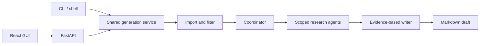

# ReadMeGen

**Generate a useful project README from the code you already have.**

ReadMeGen inspects a local directory, ZIP archive, or public Git repository and produces a Markdown draft grounded in source-file evidence. Use your terminal or launch the bundled browser interface with one command.

```bash
readmegen generate ./my-project
readmegen ui
```

## Features

- **Source-based research:** a coordinator assigns specific files to focused research agents; a separate writer turns their findings into documentation.
- **Two interfaces, one engine:** CLI and browser share ingestion rules, generation, settings, and provider adapters.
- **Your connection, your model:** Gemini, OpenAI, and Anthropic API keys; an experimental ChatGPT-plan connection for eligible local installations.
- **No project `.env` editing:** hidden key prompts, OS credential storage, session-only GUI connections, or environment variables for automation.
- **Protected outputs:** the CLI writes `README.generated.md` and refuses to replace existing files without `--force`.
- **Local GUI:** Python serves the compiled React app and API together. End users do not need Node.js.
- **Formatted README preview:** review headings, lists, code blocks, tables, links, and checklists in a responsive document view. Copy and download retain the Markdown source.

Review the generated draft before committing it. Selected source files are sent to the chosen provider. Filename filtering cannot guarantee detection of every embedded secret.

## Install from GitHub

Requires Python 3.12+. Git is needed for repository imports. Node.js 22.12+ and npm are needed only to build the GUI from source.

```bash
git clone https://github.com/FerjaniMedAmine/ReadMeGen.git
cd ReadMeGen
python -m venv .venv
source .venv/bin/activate
python -m pip install -e '.[web]'
npm ci --prefix frontend
python scripts/build_frontend.py
readmegen ui
```

On Windows, activate with `.venv\Scripts\Activate.ps1`. For CLI-only installation, omit the `web` extra and frontend build.

### Install a release

Release wheels and source distributions include the GUI. Install a downloaded wheel with:

```bash
python -m pip install './readmegen_agent-0.3.0-py3-none-any.whl[web]'
```

Install from PyPI with `pip install 'readmegen-agent[web]'` or `pipx install 'readmegen-agent[web]'`. The terminal command and Python import package are both `readmegen`.

## Choose authentication and model

Run `readmegen setup`, or use the connection panel in `readmegen ui`.

For an API key, choose Gemini, OpenAI, or Anthropic, enter the key, and select a model with tool-calling support. A catalog can include unsuitable models; listing does not guarantee inference access.

CLI setup saves credentials in the OS credential store. In the GUI, leave **Save credentials** unchecked for session-only use. ReadMeGen never silently falls back to plaintext credential files. With provider and model configured, interactive CLI generation can prompt for a session key when none is available.

For automation, supply credentials through your shell or CI secret manager:

| Provider | Environment variable |
| --- | --- |
| Gemini | `GOOGLE_API_KEY` or `GEMINI_API_KEY` |
| OpenAI | `OPENAI_API_KEY` |
| Anthropic | `ANTHROPIC_API_KEY` |

```bash
readmegen generate ./project --provider gemini --model YOUR_MODEL_ID
```

Environment keys take precedence over saved/session keys. `READMEGEN_PROVIDER` and `READMEGEN_MODEL` override saved preferences; command options override those preferences for a generation run.

### Sign in with ChatGPT — experimental

Choose **Continue with ChatGPT**, authorize plan usage in your browser, then select an account model. Identity sign-in alone does not authorize inference. Connections for different accounts and workspaces remain separate; usage counts toward the account's plan limits.

The adapter follows OpenAI's local/open-source preview contract: loopback OAuth with PKCE, ID-token verification, token refresh, account-specific catalogs, and streamed Responses requests with `store=false`. It preserves reasoning/tool history and accepts only completed responses.

OAuth and transport behavior are covered by simulated tests. **Validate live sign-in and generation with an eligible account before treating this connection as stable.** Paid or remotely hosted apps require separate onboarding. See [OpenAI's integration documentation](https://developers.openai.com/siwc/token-sharing-open-source) and [preview limitations](https://developers.openai.com/siwc/token-sharing-open-source/preview-limitations).

## Usage

```bash
readmegen generate .
readmegen generate project.zip --output docs/README.draft.md
readmegen generate https://github.com/owner/repo
readmegen generate . --output README.md --force
readmegen models
readmegen logout
readmegen ui --no-browser --port 8080
readmegen shell
```

In the interactive shell, `/ui` launches the GUI and prints its address. `/ui --no-browser` prints it without opening a browser; repeating `/ui` reuses the shell's server. Other commands: `/setup`, `/models`, `/generate`, `/logout`, `/help`, `/exit`.

On Windows, use a full project path and quote paths containing spaces. For example, in PowerShell or Command Prompt:

```powershell
readmegen generate "C:\Users\Alice\Desktop\My Project"
```

At the `readmegen>` prompt, use `/generate` instead:

```text
/generate "C:\Users\Alice\Desktop\My Project"
```

Version 0.2.1 fixes the interactive shell removing backslashes from unquoted Windows paths. Windows shell arguments preserve backslashes, including UNC paths and quoted trailing separators.

The GUI binds only to `127.0.0.1`. The default port is 8765; if occupied, the launcher selects a free port. An explicitly requested occupied port fails clearly; `--port 0` chooses a free port. Keep the terminal running. Ctrl+C or shell exit stops the server.

## How it works



The coordinator assigns up to eight specialists, each with up to twelve unique paths. Readers access only assigned files within the project and return bounded, numbered source excerpts. The writer uses their research reports; missing essential information becomes an open question.

Limits include 50 MB compressed ZIPs, 300 MB retained extracted/downloaded data, 3,000 readable files, 500 KB per source file, bounded graph recursion, and a generation timeout. ZIP traversal, symlinks, duplicate paths, and encrypted files are rejected. Git imports restrict HTTPS hosts and disable redirects, hooks, helpers, and submodules. Ingestion never executes repository code. These controls bound resources, not monetary cost: one generation may make multiple model requests.

## Structure

```text
src/readmegen/
  cli.py          CLI and interactive shell
  config.py       Validated preferences
  auth/           OS credentials and ChatGPT OAuth
  providers.py    Model clients and catalogs
  sources.py      Local, ZIP, Git ingestion
  generation/     Coordinator, readers, writer, plan adapter
  service.py      Shared generation use case
  web/            Local API, persistent jobs, GUI launcher
frontend/         React interface and API client
tests/            Workflow, CLI, security, OAuth, API tests
scripts/          GUI build and distribution verification
docs/             Architecture and release instructions
```

Preferences and public registration metadata use the platform's user configuration directory. Web jobs and generated documents use the user cache directory. Imported source is temporary; uploads are removed after processing. Jobs older than seven days are removed when the server next starts. `READMEGEN_HOME` overrides these locations for isolated development/testing.

## Development and checks

```bash
python -m pip install -e '.[web,dev]'
npm ci --prefix frontend
ruff check src tests scripts
ruff format --check src tests scripts
pytest --cov=readmegen --cov-report=term-missing
npm run lint --prefix frontend
npm test --prefix frontend
python scripts/build_frontend.py
python -m build
twine check dist/*
python scripts/check_distribution.py dist
```

For frontend development, run `readmegen ui --no-browser --port 8765` and `npm run dev --prefix frontend`. Vite proxies `/api` to Python. Rebuild bundled assets after changes; end-user installations never start Vite.

CI tests Python 3.12–3.14 on Linux and CLI/path handling on Windows, lints both interfaces, audits npm dependencies, verifies distributions, and installs a wheel outside the checkout. Tests use simulated models and credentials and need no paid inference.

Read [architecture and tradeoffs](docs/architecture.md) and [release instructions](docs/releasing.md). Licensed under [MIT](LICENSE).
